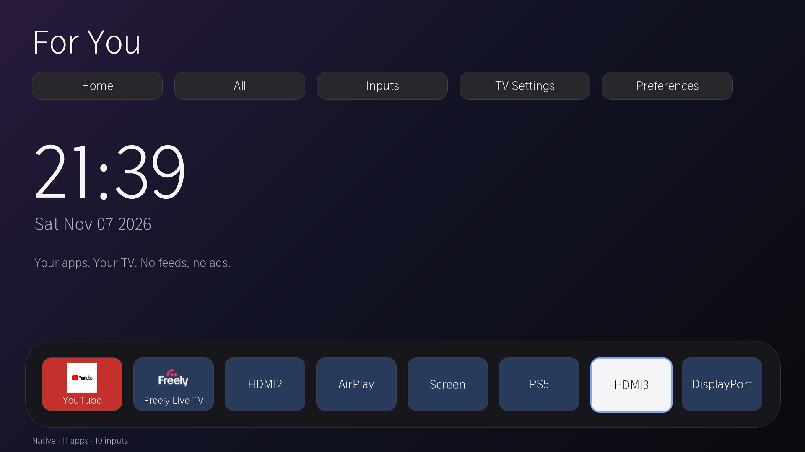

# 75U8QTUK (UK) — V0000.09.60I.Q0813 — VIDAA U9 on MTK9655

**Status (2026-11-07, updated after findings/11): ROOT ARMED AND
BOOT-PERSISTENT, NATIVE HOME INSTALLED AND OWNER-VERIFIED ACROSS A REBOOT.**
The alvidaa DOM launcher replaces the stock Home via a component-only swap in
the writable operation-ui module; apps, inputs, TV Settings and app launch were
all confirmed on screen. The current bundle (v2) also merges apps and inputs
into one list and adds a CSS-gradient wallpaper picker in Preferences
([findings/10](findings/10-native-home-customization.md)). A `re_sshd` service
now re-arms root SSH automatically at every boot — verified by a supervised
reboot in [findings/11](findings/11-boot-persistence.md). Rollback is one
command ([findings/09](findings/09-native-home.md)); the persistence hook has
its own one-command teardown (findings/11).



*Post-reboot Home: merged apps+inputs shelf, Dusk wallpaper, clock `21:39`,
`Sat Nov 07 2026`. No Device ID, Netflix ESN, serial, MAC or LAN address
appears in the frame, so this capture is committed as evidence.*

Historically a real reboot confirmed **no automatic autostart**; the
documented `83` + `82` sequence restored uid-0 SSH afterwards with no
re-download ([findings/08](findings/08-reboot-rearm.md)), until that step was
automated in [findings/11](findings/11-boot-persistence.md). Initial arm: fingerprint
captured; pairing confirmed (Sidee, profile `modern`); launcher GET-delivery
confirmed; Phoenix FaaS confirmed present. The earlier "dead end"
(findings/04) was a **false negative**: that probe used the `hiutils` read
surface with a bare-string path, and never started `basic/fetcher`. Re-probed
with the chain's actual primitive, `fetchFile` returned `ret:true, "download
finished"` for writes to `/APPS` **and** the `tv.vidaa.jsservice.basic/CHA/`
package tree ([findings/05](findings/05-fetcher-recheck.md)). All four
build-dependent prerequisites were then measured ([findings/06](findings/06-superwatch-gate.md)),
and the chain was armed on 2026-11-06
([findings/07](findings/07-root-armed.md)): the IPK `postinst` ran as
**uid 0 / `CapEff 000001ffffffffff`**, and `ssh -p 8008 root@<tv-ip>`
(via `server/keys/vidaa_75u8qtuk_ed25519`) gives uid 0 with a working PTY.
The manual re-arm page remains the fallback if the hook is ever torn down.
`/` and `/application` remain read-only; dm-verity untouched.
Do not treat this page as a recipe; it's the lab notebook's cover sheet.

**Contributor:** [@kingpandacc](https://github.com/kingpandacc).
**PRs:** [fork #1](https://github.com/Kingpandacc/alvidaa/pull/1) and
[upstream #28](https://github.com/carteakey/alvidaa/pull/28).
**Region:** UK (`GBR`, language `en-GB`). The existing `V0000.09.60I.Q0813`
record is from an EU_A unit; the region delta is the first thing to re-check
on the MQTT pairing profile.

> **The chain this guide expects to apply is written up in full on the
> 100U7Q:** [`../../100U7Q/V0000.09.60I.Q0813/README.md`](../../100U7Q/V0000.09.60I.Q0813/README.md).
> Read that first. This page tracks only the deltas this specific unit shows,
> and which of the chain's build-dependent prerequisites are confirmed here.

## Device fingerprint

| Field | Value | Source |
|---|---|---|
| Retail model | 75U8QTUK (75″ U8Q, UK SKU) | sticker + owner |
| Series / generation tag | U8Q | on-device `U8Q Browser Environment` page header |
| Firmware | **`V0000.09.60I.Q0813`** | About → *Software Version* (also returned by `Hisense_GetFirmWareVersion()` via the user's browser-env page) |
| Extended version | `X0001.W01.Y01.J01` | About |
| Minor version | `I.Q0813.9.06.00-a20260731p` | About — build tag `a2026-07-31p` |
| RC version | `ERF6H66V1.03` | About |
| SoC (vendor-reported) | **`MTK9655`** | `Hisense_GetChipSetName()` |
| Kernel | **aarch64** (Linux, 64-bit) | `navigator.platform = "Linux aarch64"` |
| Userland arch | **32-bit ARM** (`EM_ARM`) | in-process FaaS probe: `process.arch: "arm"`, phoenix worker (findings/06) |
| VIDAA OS | `U09.60` | firmware id class + `Q0813` tag |
| Browser | Chromium 111 "WebViewer/1.2.1" (odin class) | `navigator.userAgent` |
| UA string | `Mozilla/5.0 (X11; Linux aarch64) AppleWebKit/537.36 (KHTML, like Gecko) Chrome/111.0.0.0 WebViewer/1.2.1 Safari/537.36` | on-device readout |
| Language | `en-GB` | `navigator.language` |
| `secureContext` | `false` on the loaded page | expected — TV browser served the page over plain HTTP |
| `transport_protocol` (SSDP) | **not exposed** | TV `dd.xml` on :3366 is a 417-byte stub, no such field (findings/01) |
| Region (`Hisense_GetRegion`) | **`EU_A`** | on-TV probe — same region class as 100U7Q, not UK-specific (findings/03) |
| Country (`Hisense_GetCountryCode`) | **`GBR`** | on-TV probe (findings/03) |
| Full model (`Hisense_GetModelName`) | **`75U85QEVS`** | on-TV probe; `GetSerialType`=`75U8QE`, sticker `75U8QTUK` (findings/03) |
| Serial number / internal board code | owner-redacted / pending `Hisense_GetSerialType()` | |
| Netflix ESN, Device ID | owner-redacted (not committed) | PII; kept in private notes |

Nmap of the TV from the LAN (owner-run, 2026-11-06):

```
PORT       STATE     SERVICE     VERSION
80/tcp     filtered  http
443/tcp    filtered  https
8000/tcp   filtered  http-alt
8080/tcp   filtered  http-proxy
8770/tcp   filtered  apple-iphoto
9009/tcp   filtered  pichat
36669/tcp  open      ssl/unknown
```

Consistent with the expected VIDAA LAN posture (MQTT-over-TLS on **36669**
only; phoenix on `9009` is localhost-only). **After arming (findings/07),
TCP 8008 is now open LAN-wide** and appears in a fresh nmap; Dropbear listens
on `0.0.0.0:8008`, key-only. Since findings/11 it is re-armed automatically
at every boot by the `re_sshd` service, so this port is now permanently open
at every cold boot (accepted trade-off).

## Chain prerequisites on this unit

| Chain prerequisite | 100U7Q record | 75U8QTUK observation | State |
|---|---|---|---|
| **Same firmware id** (not necessarily the same build) | `V0000.09.60I.Q0813` on MT9655 | `V0000.09.60I.Q0813` on `MTK9655` | matches — strong |
| **aarch64 kernel + 32-bit ARM userland** | kernel `5.15.192`, ELF `EM_ARM` | aarch64 kernel confirmed (UA + `platform`); **userland ARM32 confirmed** (`process.arch: "arm"`, phoenix binary; findings/06) | **CONFIRMED live** |
| **Chromium 111 webview** | Chromium 111 (odin) | Chrome/111 WebViewer/1.2.1 | matches |
| **Phoenix FaaS stack present** (`http://localhost:9009`, `wss://localhost:9888`) | yes | **confirmed** — `9009` GET→200 (`sdkVersion 1.5.0`), `9888` WS opens (findings/03) | **CONFIRMED live** |
| **`basic/fetcher` `fetchFile` write primitive** (the keystone) | yes (`"permission": {}`) | **OPEN** — `ret:true, "download finished"`; markers written to `/APPS` and `…/basic/CHA/` (findings/05) | **CONFIRMED live** |
| **`/APPS/pkgs/tv.vidaa.jsservice.basic/CHA/functions/fetch/` writable by uid 314** | yes (write primitive) | **CONFIRMED** — marker write into `…/basic/CHA/` succeeded (findings/05) | **CONFIRMED live** |
| **`hiutils.fileRead` traversal** (recon/logs; not required to write) | yes, string path | **OPEN with array path** — `path:["../proc/uptime"]` reads; bare string → `invalid path` (findings/05) | **CONFIRMED live (array form)** |
| **`/var/run/superwatch_socket` reachable from app uid 314 (group 616)** | yes | **CONFIRMED** — uid 314 groups include 616; `connect()` OK; command `85` → `901:0` (findings/06) | **CONFIRMED live** |
| **`/var/local` writable by uid 314** (not required by the 100U7Q chain; widens options) | not writable by uid 314 on 100U7Q | **writable** — write/read/unlink of `/var/local/.recon_write_test` succeeded (findings/06) | **CONFIRMED live** |

All four 100U7Q chain prerequisites were measured on this unit: the FaaS
write, the package-tree writability, the superwatch socket (group 616 +
command `85` → `0`), and 32-bit ARM userland. The chain was then armed on
2026-11-06 — `postinst` as uid 0 with full capabilities, root SSH on 8008
with the dedicated key, PTY working. See
[findings/07](findings/07-root-armed.md) for the artifacts, hashes,
verification transcript and rollback.

## Deltas from 100U7Q that this unit will show

- **Country vs region:** country code `GBR`, but internal region is `EU_A`
  — the same region class as the 100U7Q reference. The credential cascade
  this page expected to re-walk already resolved: Sidee paired on `modern`
  (findings/02, findings/03).
- **`hiutils` path arg shape:** bare-string paths containing `../` are
  rejected `invalid path`; the same path in a one-element array traverses
  (`path:["../proc/uptime"]`). The 100U7Q examples that pass strings do not
  transplant verbatim — use the array form (findings/05).
- **Panel / SKU:** 75″ U8Q vs 100″ U7Q. HDMI count, panel driver, input list
  and the launcher tile layout differ. None of that touches the root chain.
- **Build-tag suffix:** the About screen shows the build id
  `I.Q0813.9.06.00-a20260731p`; the 100U7Q record did not note a Minor
  Version string explicitly, so this is new context, not a conflict.
- **Remote hardware:** `ERF6H66V1.03`. Different silicon can mean different
  `irkey` tables in RemoteNow — only relevant if we ever wire up IR replay.

## Safety / ground rules (restated)

Per [AGENTS.md](../../../../AGENTS.md):

- LAN-only, on the owner's own TV. No DRM circumvention. No OTA writes.
- Reversibility is the design law: the 100U7Q chain writes to `/APPS/pkgs`
  and installs a package; the uninstall path (`pkgmgr` opcode `83`) is in the
  parent guide. Nothing on `/` is touched (erofs, dm-verity enforcing).
- **One MQTT server per TV.** If the owner has another pairing session
  active, kill it before re-pairing from `server/pair.py`.
- Keys stay in `server/keys/`. The Device ID, Netflix ESN and serial seen in
  the owner's About screen are deliberately **not** committed; they're
  device-identifying.

## Next up

In order, per the AGENTS.md onboarding ladder. Steps 1–5 are done on this
unit; root is armed **and boot-persistent** (findings/11), and the native Home
survives a reboot.

1. **SSDP descriptor.** ✅ Done 2026-11-06 (findings/01). The descriptor on
   `:3366` is a 417-byte stub — no `transport_protocol`, empty
   `serviceList`, `modelName` `75U8QE`. Pairing was handled by Sidee
   (profile `modern`), so the cascade it would steer is moot.
2. **Full fingerprint.** ✅ Done 2026-11-06 (findings/03). Phoenix FaaS
   present (`9009` GET 200, `9888` WS opens), `Hisense_*` sweep captured,
   region `EU_A`, country `GBR`, full model `75U85QEVS`.
3. **Launcher lane.** GET delivery is ✅ (a served page loads in the TV
   webview, findings/03). The **native DOM Home is now installed** ✅
   (findings/09): a component-only `/Launcher` route swap in operation-ui
   `app.js`, verified by the owner for apps, inputs, TV Settings and app
   launch. The older browser/canvas tile self-install (`hookinstall.html` /
   `Appinfo.json`) is still **untested** and is a separate lane.
   `server/pair.py` was not run — Sidee holds the single MQTT session.
4. **Bridge recon with writes.** ✅ Done and **corrected 2026-11-06**
   ([findings/05](findings/05-fetcher-recheck.md),
   [findings/06](findings/06-superwatch-gate.md)). The FaaS `basic/fetcher`
   `fetchFile` write returned `ret:true, "download finished"` to two paths,
   including `…/basic/CHA/`; `hiutils.fileRead` traversal works with the
   array path form. findings/04's dead end is superseded. The two markers
   were deleted by the findings/06 probe; the probe and cleanup functions
   self-deleted.
5. **Root lane.** ✅ **ARMED 2026-11-06** ([findings/07](findings/07-root-armed.md)).
   Built a fresh static ARM32 Dropbear 2022.83 + minimal IPK
   (`tools/u7q/scripts/make_min_installer.py`), wrote it with `fetchFile`,
   and sent `83` then `82` through `sw2.js`. `postinst` ran as uid 0 with
   `CapEff 000001ffffffffff`; verified:
   `ssh -p 8008 -i server/keys/vidaa_75u8qtuk_ed25519 root@<tv-ip>`
   → uid 0, full caps, **PTY OK**, `/etc/shadow` and `/data` readable.
   `/` and `/application` are still `erofs ro`. Initially there was no boot
   persistence: after a real reboot 8008 was closed; re-sending `83` + `82`
   through `sw2.js` restored uid-0 SSH with the same host key and a fresh
   daemon ([findings/08](findings/08-reboot-rearm.md)). **That is now
   automated** ([findings/11](findings/11-boot-persistence.md)): a `re_sshd`
   service in `tv.vidaa.jsservice.basic/CHA/services/` re-arms at every boot,
   verified by a supervised reboot (uptime reset, marker `ARMED: dropbear up`,
   no browser re-arm). Re-arm page `tools/u7q/web/rearm.html` served by
   `tools/u7q/web/server.py` remains the fallback. The IPK remains at
   `/APPS/installer.ipk`, so re-arm downloads nothing. Rollback is
   in findings/07.

Each discovery, bug, trap, errno gets a dated note in
[`findings/`](findings/) the same hour it happens — AGENTS.md discipline rule.

## Open questions

- ~~Does the UK SKU ship the same `fetcher` FaaS permission block the EU_A
  100U7Q had?~~ **Resolved (findings/05):** yes — `fetchFile` writes
  succeeded (`ret:true, "download finished"`), so the block is empty/open.
- ~~**Is `/var/run/superwatch_socket` reachable from the app uid (group
  616) on this unit?**~~ **Resolved (findings/06):** yes — uid 314's
  supplementary groups include 616, `connect()` succeeded, and command `85`
  returned `901:0` (code `0`).
- ~~Is the userland 32-bit ARM (`EM_ARM`) like the 100U7Q?~~ **Resolved
  (findings/06):** yes — the phoenix Node worker reports
  `process.arch: "arm"`.
- Is the `/data` partition writable by the app uid on this unit? (Was not
  on the 100U7Q — if that changed on the UK build, it widens options.)
- Why does `websdk/Appinfo.json` read back as `{"AppInfo":[]}`? Possibly
  the wrong registry file or a genuinely empty tile list; it matters for
  the launcher tile lane, not the root lane (findings/05).
- ~~`Hisense_GetCountryCode()` output — `GBR`?~~ **Resolved (findings/03):**
  `GBR`, region `EU_A`. The SSDP descriptor carries no `transport_protocol`
  digit on this build (findings/01), and Sidee already paired on profile
  `modern`, so the cascade this would have steered is moot.

## References

- Parent chain: [100U7Q / V0000.09.60I.Q0813](../../100U7Q/V0000.09.60I.Q0813/README.md)
  (same build, verified root chain)
- Boot-persistence adapter idea: [75UR9S / V0000.09.60W.Q0624](../../75UR9S/V0000.09.60W.Q0624/README.md)
  (`re_sshd` serviceList autostart; different build letter, same SoC family)
- Method catalogue: [docs/research/EXPLOITS.md](../../../research/EXPLOITS.md)
- Project ground rules: [AGENTS.md](../../../../AGENTS.md)
