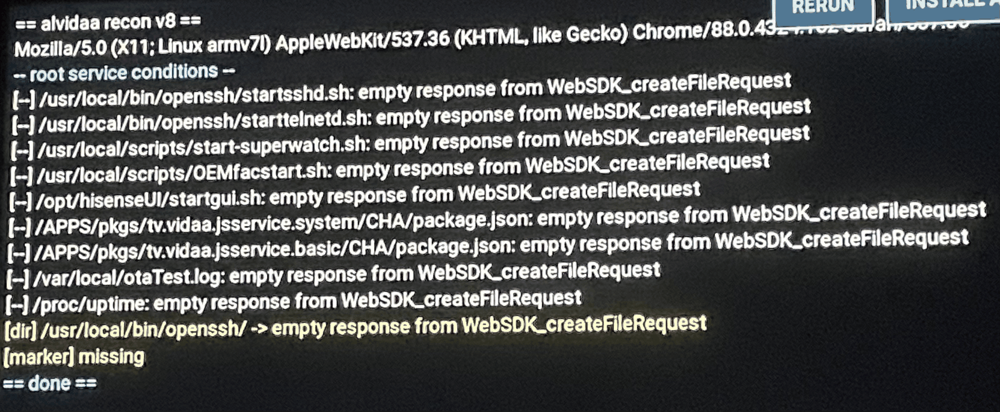
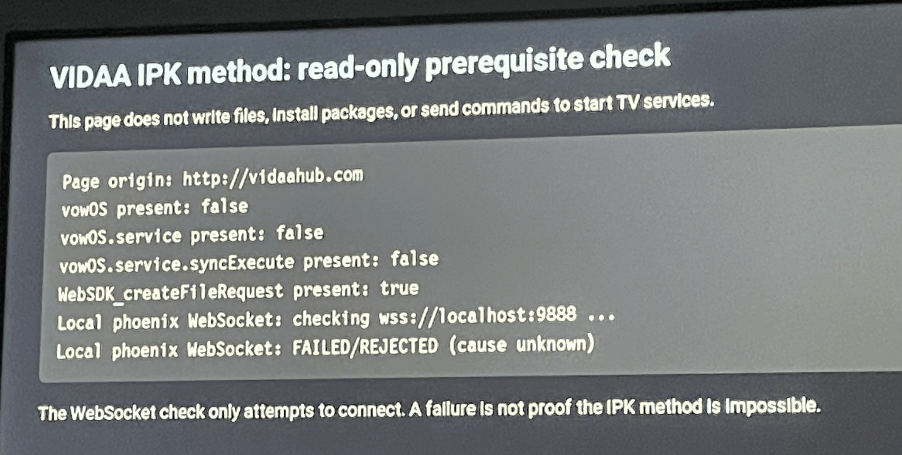
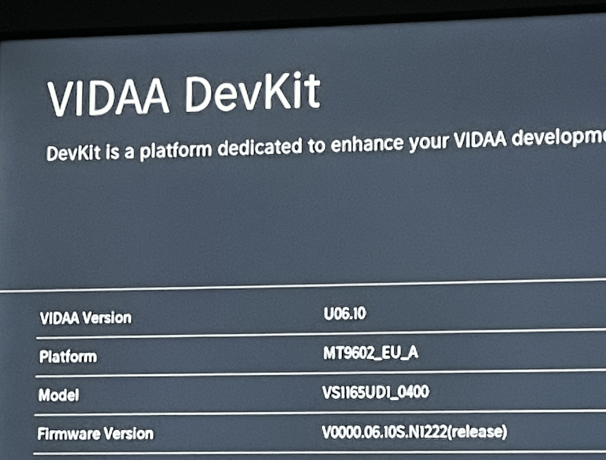

# Toshiba / Vestel VS1165UD1_0400 — V0000.06.10S.N1222

## Device information

| Field | Observed value |
| --- | --- |
| Manufacturer | Toshiba / Vestel |
| Internal model (VIDAA DevKit) | `VS1165UD1_0400` |
| VIDAA version | `U06.10` |
| Firmware (DevKit) | `V0000.06.10S.N1222` (release) |
| Platform (DevKit) | `MT9602_EU_A` |
| Chipset | MediaTek MT9602 |
| Browser | Chromium 88, ARMv7 Linux user agent |
| RemoteNow transport protocol | `2140` |

The internal model, platform, and firmware were read directly from the VIDAA DevKit information screen. The retail model was not established.

## Observed behaviour

### MQTT pairing

RemoteNow pairing completed using `vidaa-control`. This does not imply the alvidaa launcher or home-watcher paths work; those were not tested.

### Browser filesystem preflight — unsuccessful

- A local HTTP page was served to the TV browser through `http://vidaahub.com` using temporary local DNS redirection.
- The browser exposed `WebSDK_createFileRequest`.
- Direct JavaScript file-read probes, including a `../proc/version` path, returned an empty string (`""`).
- The alvidaa **recon v8** page completed its checks but reported `empty response from WebSDK_createFileRequest` for all of its file-read attempts, including `/proc/uptime`, startup scripts, package metadata, and `/var/local/otaTest.log`.
- The diagnostic displayed `[marker] missing`, but the read failure means this is not reliable evidence of the hook's presence or absence.
- **No filesystem write, root-hook installation, root-shell execution, or persistence test was performed.** The documented browser traversal/boot-hook method was not shown to work on this device. The empty responses alone do not identify the underlying restriction.

### IPK prerequisite exploration — inconclusive

- A read-only page in the **normal TV browser** reported that `vowOS`, `vowOS.service`, and `vowOS.service.syncExecute` were not exposed as JavaScript globals.
- A browser WebSocket connection to `wss://localhost:9888` failed or was rejected, without a reason being identified.
- Navigating the browser to `http://localhost:9009/` produced a white page; this does **not** demonstrate that the relevant package-service endpoint is available or unavailable.
- VIDAA DevKit could be installed from the TV interface, but it required authorisation for application development; no developer application was run.
- **No IPK package was transferred or installed.** The IPK root method remains untested.

## Status / limits

Root access has **not been achieved**, but this device is **not proven unrootable**. Only the observed browser-based filesystem preflight failed; other chains are untested or inconclusive. The TV was not flashed or modified by a root payload.

## Evidence

The following photographs were captured during owner testing. Images are linked using relative paths and should be placed alongside this README.

### alvidaa recon v8 — browser filesystem tests

The diagnostic completed, but its file reads returned `empty response from WebSDK_createFileRequest`. These results do not establish the cause of the failure or demonstrate that all root methods are blocked.

### IPK method — browser prerequisite check

In the normal TV browser, `vowOS.service.syncExecute` was not exposed and the WebSocket attempt to `wss://localhost:9888` failed or was rejected. No IPK installation was attempted.

### VIDAA DevKit — device identifiers

The DevKit information screen confirms `VS1165UD1_0400`, platform `MT9602_EU_A`, VIDAA `U06.10`, and firmware `V0000.06.10S.N1222`.

## What this guide includes and leaves out

This guide documents the Toshiba VS1165UD1_0400 running firmware V0000.06.10S.N1222.

Included:
- Confirmed TV hardware and firmware information.
- MQTT pairing results.
- Unsuccessful browser filesystem tests.
- Inconclusive IPK prerequisite tests.
- Screenshots of the diagnostic results.

Not included:
- A working root exploit.
- Root installation instructions.
- Unverified filesystem write methods.
- Vendor binaries or private credentials.

Root access has not been achieved, and other rooting methods remain untested.

## Teardown

No root payload, IPK package, or boot hook was installed.

To restore the testing environment:
1. Stop the temporary HTTP and DNS servers on the PC.
2. Restore the TV's DNS configuration to Automatic.
3. Remove DevKit through the TV's app management interface if removal is supported and desired.

No firmware was flashed or modified during testing.
